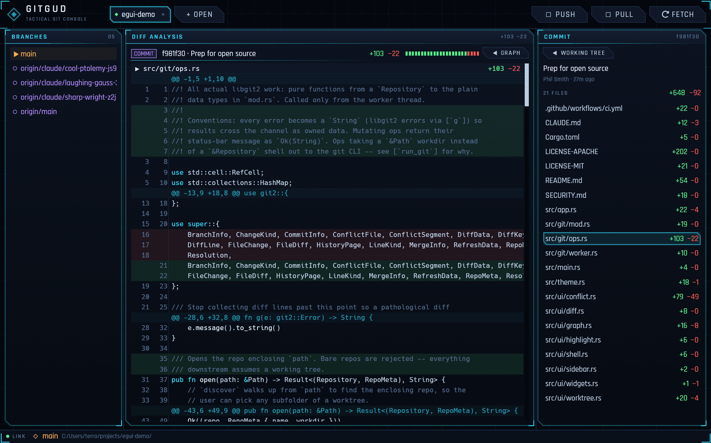

# GITGUD

A git GUI for Windows with a sci-fi HUD aesthetic. Single ~4 MB executable, no install, no telemetry.



Stage, commit, branch, merge, and resolve conflicts through libgit2; fetch, pull, and push shell out to your real git CLI so your existing credential helpers and SSH agent just work.

## Download

Grab `gitgud.exe` from the [latest release](https://github.com/tornupgaming/gitgud/releases/tag/latest) — rebuilt automatically from every push to `main`. Run it; nothing else to set up.

Requirements: Windows 10+, and `git` on `PATH` for fetch/pull/push (everything local works without it).

## Features

- **Tabs** — open any number of repos; the list persists across launches.
- **Working tree** — stage/unstage per file or all at once, discard with confirm, commit with `Ctrl+Enter`.
- **Commit graph** — multi-lane DAG with ref chips and a WIP row, paged 250 commits at a time.
- **Diff viewer** — syntax-highlighted, virtualized, handles large diffs without stutter.
- **Merging** — merge any branch, then resolve conflicts block-by-block (ours / theirs / both) in a dedicated UI; binary and delete conflicts get whole-file resolution.
- **Network** — fetch / pull (`--ff-only`) / push run on their own thread, so the UI and local operations never block on the network.
- **Auto-refresh** — a file watcher picks up external changes (editor saves, terminal git commands) without refocusing.

Shortcuts: `F5` refresh · `Ctrl+Enter` commit · `Ctrl+P` push.

## Building from source

```
cargo run --release
```

That's it. Rust 1.85+ (edition 2024). The release profile is size-optimized (LTO, `opt-level = "s"`, stripped, `panic = "abort"`) — binary size is a tracked feature, so avoid adding dependencies casually and keep `default-features = false` trimming intact.

`cargo test` runs the unit tests; `cargo clippy` and `cargo fmt` are enforced in CI. To catch formatting locally, enable the bundled pre-commit hook once per clone:

```
git config core.hooksPath .githooks
```

## Architecture

Two threads, message passing, no locks:

- The **UI thread** (`src/app.rs`, `src/ui/`) never touches `git2::Repository`. It sends `Job` values to the worker and drains `Update` replies once per frame.
- The **worker thread** (`src/git/worker.rs`) owns all repository handles and executes jobs sequentially. Network jobs get a throwaway thread each and shell out to the git CLI.
- The **contract** (`src/git/mod.rs`) is plain owned data — every `Job` except `Close` produces exactly one `Update`.
- **Operations** (`src/git/ops.rs`) are pure functions `Repository -> data`, called only from the worker.

All colors, fonts, and paint primitives live in `src/theme.rs`; UI panels are drawn as chamfered HUD "modules". The bundled Rajdhani font is licensed under the [SIL OFL](assets/fonts/OFL.txt).

State on disk: the open-repo list at `%APPDATA%\gitgud\repos.txt`. Nothing else.

## Security model

Opening a repository and running operations in it is treated like running `git` in that repository yourself: repo-local hooks run. Config-based command execution that git would *not* run interactively is blocked — CLI invocations neutralize `ext::` remote URLs and command-valued `core.fsmonitor`, index paths are confined to the worktree, and untrusted file content is size-capped before highlighting. Don't run network operations in repositories you don't trust. See [SECURITY.md](SECURITY.md) for reporting.

## License

Dual-licensed under [MIT](LICENSE-MIT) or [Apache-2.0](LICENSE-APACHE), at your option. Contributions are accepted under the same terms.
